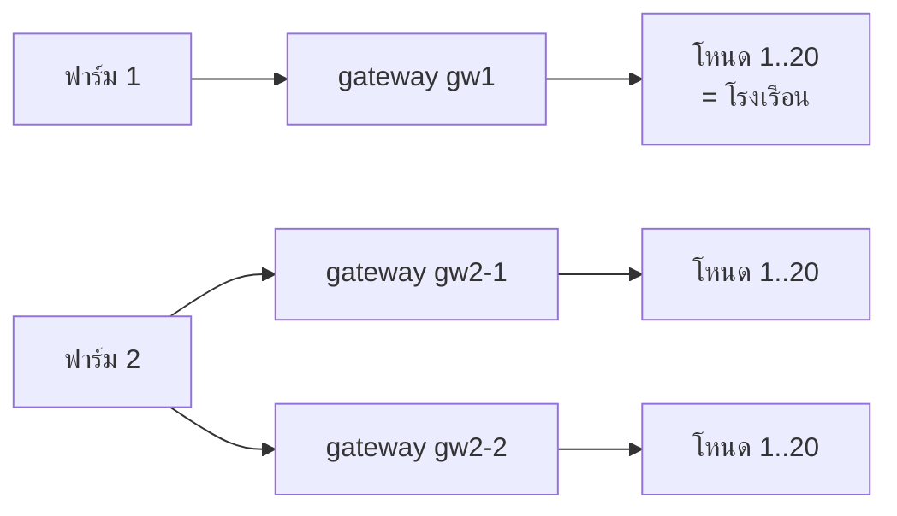

# Smart Chicken Farm v3.3 — หลายฟาร์ม · หลายโรงเรือน · ผู้ดูแลฟาร์ม → ผู้ดูแลโรงเรือน · ความปลอดภัยของเซนเซอร์

ระบบติดตามและควบคุมโรงเรือนไก่เนื้อ: ESP32 + SHT31 · ESP-NOW (HMAC) · MQTT (Mosquitto) · Node-RED · Supabase

## เริ่มใช้งาน (Mac)

1. ติดตั้ง **Docker Desktop** (ครั้งเดียว)
2. Supabase → SQL Editor → วาง `supabase/setup.sql` → Run
   - รันได้ทั้งโปรเจกต์ใหม่และของเดิม: ย้ายข้อมูลเก่าเป็น "ฟาร์มหลัก" + gateway `gw1` + โรงเรือน 1–3 ให้อัตโนมัติ ประวัติไม่หาย
   - จาก v3: "หัวหน้าฟาร์ม" และ "พนักงานเลี้ยง" กลายเป็น **ผู้ดูแลฟาร์ม** ของฟาร์มเดิม · จาก v3.1: "ผู้ดูแลโรงเรือน" ยังเป็นผู้ดูแลโรงเรือนของโรงเดิม (คนที่ถูกย้ายต้อง login ใหม่)
   - v3.3 เพิ่มตาราง `user_coops` (ผู้ดูแลโรงเรือน ↔ โรงเรือนที่ดูแล), บทบาท `coop_keeper` และ `farms.farm_key` (กุญแจฟาร์มสำหรับไฟล์บอร์ด) — **ต้องรันไฟล์นี้ใหม่ก่อนเปิดระบบ** ไม่งั้น Node-RED โหลดข้อมูลไม่ได้
   - ทุกครั้งที่ไฟล์นี้อัปเดตให้รันซ้ำ
3. ดับเบิลคลิก **`start.command`** (บอร์ดจริง) หรือ **`start-demo.command`** (ไม่มีบอร์ด) — สคริปต์จะ:
   - สร้างกุญแจ/รหัสผ่านทุกตัวแบบสุ่ม (`.env`): session secret, บัญชี MQTT ของ Node-RED และ gw1, รหัส Node-RED editor, รหัส admin แรก, กุญแจฟาร์ม
   - เขียน `firmware/*/secrets.h` (IP เครื่อง, รหัส MQTT ของ gw1, กุญแจฟาร์ม, รหัส Wi-Fi)
   - เปิด Mosquitto + Node-RED แล้วตรวจ: Supabase ต่อได้, API ปฏิเสธคนที่ไม่ login, broker ปฏิเสธการต่อที่ไม่มีรหัส
   - **แสดงชื่อผู้ใช้/รหัสผ่านบัญชีเว็บแรก (admin)** → เข้าแล้วเปลี่ยนรหัสที่เมนูบัญชี
4. เข้าเว็บ → เมนู **เริ่มต้นใช้งาน** ทำตามทีละขั้น (ติ๊กให้เองเมื่อเสร็จ)
5. แฟลชบอร์ดจากเมนู **ตั้งค่าบอร์ด** (ไม่ต้องแก้โค้ดเอง):
   1. เลือกตัวแม่และโรงเรือน (โรงที่ยังไม่ผูกบอร์ดได้ NODE_ID ที่ว่างให้เอง)
   2. กรอก Wi-Fi 2.4 GHz (รหัส Wi-Fi ใส่ไฟล์ในเบราว์เซอร์ ไม่ส่งไป server) + IP เครื่อง (ใส่ให้จาก start.sh)
   3. กด **ดาวน์โหลดไฟล์บอร์ด (.zip)** → แตกไฟล์ → เปิด `gateway/gateway.ino` แฟลชตัวแม่, `nodeN/nodeN.ino` แฟลชตัวลูกของแต่ละโรง (secrets.h ใส่ค่าครบ: MQTT, FARM_KEY, NODE_ID)
   4. ขั้นที่ 4 ของหน้านั้นติ๊กเขียวเมื่อตัวแม่ออนไลน์และแต่ละโรงส่งค่า · ถ้าไม่ขึ้นมีตาราง Serial Monitor → วิธีแก้
   - Arduino IDE ครั้งแรก: Boards Manager "esp32 by Espressif" · Library: PubSubClient, Adafruit SHT31 · บอร์ด ESP32 Dev Module · SHT31: SDA 21, SCL 22

| ที่อยู่ | ใช้ทำอะไร |
|---|---|
| `http://localhost:1880` | เว็บ (ต้อง login) · มือถือใช้ `http://<IP เครื่อง>:1880` |
| `http://localhost:1880/admin` | Node-RED editor (ผู้ใช้ `admin` รหัส `NR_EDITOR_PASSWORD` ใน `.env`) |
| `mqtt://<IP>:1883` | เฉพาะ gateway ที่มีบัญชี |

---

## 1. Scalability: เพิ่มฟาร์ม / เพิ่มโรงเรือน



- **ฐานข้อมูล:** `farms → gateways → coops` (โรงเรือน = gateway + หมายเลขโหนด) ข้อมูลทุกตาราง ผูกกับ `coop_id`
- **ไม่มีจำนวนตายตัว:** จำนวนฟาร์มไม่จำกัด · 1 ฟาร์มมีได้หลาย gateway · 1 gateway รองรับ 20 โหนด · เว็บสร้างการ์ด เมนู ตัวกรอง จากข้อมูลจริง (เมนูพับรายชื่อโรงเรือนเองเมื่อเกิน 6 โรง)
- **MQTT topic แยกตาม gateway:** `scf/<gateway>/node/<n>/telemetry | light/set | light/state` · `scf/<gateway>/status | security` → flow เดียวรองรับทุกฟาร์ม
- **ประสิทธิภาพ:** Node-RED cache โครงสร้างฟาร์มไว้ใน memory · เว็บรับข้อมูลสดแบบ push (WebSocket) · index ฐานข้อมูลตาม `coop_id, created_at`

**เพิ่มฟาร์ม (ผู้ดูแลระบบ) — หน้าต่างเดียว:** จัดการฟาร์ม → ฟาร์มทั้งหมด → **เพิ่มฟาร์ม** → กรอกชื่อฟาร์ม + ชื่อ gateway + **ผู้ดูแลฟาร์มคนแรก** (บังคับ: ทุกฟาร์มมีคนดูแลตั้งแต่สร้าง) → ระบบออกบัญชี MQTT, รหัสผ่าน, กุญแจฟาร์ม, ไฟล์ `secrets.h` และรหัสผู้ดูแล (**แสดงครั้งเดียว**) แล้วเปิดฟาร์มใหม่ให้ · ถ้าข้อมูลส่วนไหนผิดจะไม่สร้างอะไรเลย · admin สลับฟาร์มที่กำลังดูได้จากกล่องบนสุดของเมนู

**เพิ่มโรงเรือน (ผู้ดูแลฟาร์ม หรือ admin) — หน้าต่างเดียว:**
1. แฟลชบอร์ดลูกด้วย `NODE_ID` ที่ยังไม่ใช้ + `FARM_KEY` ของฟาร์ม
2. หน้าจัดการ → **เพิ่มโรงเรือน** (หรือ "ลงทะเบียนเป็นโรงเรือน" เมื่อระบบพบบอร์ดใหม่): ชื่อ · ความจุ · บอร์ดลูก (เลือกโหนดที่ว่างให้เอง) · ไฟ (สั่งเอง/ตั้งเวลา) · รุ่นไก่ (ถ้าลงไก่แล้ว)

**ปิดไฟทั้งหมด (ผู้ดูแลฟาร์ม หรือ admin):** ปุ่มเดียวที่หน้าภาพรวม → ส่ง `OFF` ให้ทุกโรงเรือนของ**ฟาร์มนั้น** · โรงที่ตั้งเวลาไว้เปลี่ยนเป็น "สั่งเอง" (ไม่งั้นตัวตั้งเวลาจะเปิดกลับ) · บันทึก audit

**ลบ (ผู้ดูแลระบบ):** ลบฟาร์ม = ปุ่ม "ลบ" ในตารางฟาร์มทั้งหมด → พิมพ์ชื่อฟาร์มยืนยัน → ลบโรงเรือนทุกหลังพร้อมประวัติ, gateway (ตัดบัญชี MQTT ทันที), บัญชีผู้ดูแล/ผู้ดูของฟาร์มนั้น ในครั้งเดียว กู้คืนไม่ได้ (audit ยังเก็บไว้) · ลบโรงเรือน = พิมพ์ชื่อยืนยัน ลบพร้อมประวัติทั้งหมด กู้คืนไม่ได้ (ถ้าแค่หยุดใช้ ให้ปิด "ใช้งาน") · ลบผู้ใช้ = ออกจากระบบทันที บันทึกเก่ายังอยู่

> ฟาร์มที่อยู่คนละที่จริง: gateway ต้องต่อเน็ตถึงเครื่อง server ได้ (server บน cloud หรือ VPN) — ตอนเดโมรันทุกอย่างบน Mac เครื่องเดียวได้

## 2. ผู้ใช้และสิทธิ์ (authentication / authorization)

| บทบาท | ขอบเขต | ดูข้อมูล | สั่งไฟ · บันทึกประจำวัน · รุ่นไก่ · เวลาไฟ | ปิดไฟทั้งฟาร์ม · เพิ่ม/แก้โรงเรือน | เพิ่ม/แก้/ลบ ผู้ดูแลโรงเรือน | ลบโรงเรือน · จัดการคนทุกบทบาท · ดู audit | เพิ่มฟาร์ม · gateway |
|---|---|:-:|:-:|:-:|:-:|:-:|:-:|
| ผู้ดูแลระบบ (admin) | ทุกฟาร์ม | ✓ | ✓ | ✓ | ✓ | ✓ | ✓ |
| ผู้ดูแลฟาร์ม (keeper) | **1 ฟาร์ม** ทุกโรงเรือน | ✓ | ✓ | ✓ | ✓ (ฟาร์มตัวเอง) | – | – |
| ผู้ดูแลโรงเรือน (coop_keeper) | **โรงเรือนที่ได้รับมอบหมาย** (1 หลังขึ้นไป ในฟาร์มเดียว) | เฉพาะโรงตัวเอง | เฉพาะโรงตัวเอง | – | – | – | – |
| ผู้ดู (viewer) | **1 ฟาร์ม** | ✓ | – | – | – | – | – |

- **ลำดับชั้น:** ผู้ดูแลระบบ → ผู้ดูแลฟาร์ม → ผู้ดูแลโรงเรือน · ผู้ดูแลฟาร์มเข้าเมนู **"ผู้ดูแลโรงเรือน"** เพื่อเพิ่ม แก้ไข (ชื่อ, โรงเรือนที่ดูแล, เปิด/ปิดบัญชี) รีเซ็ตรหัส หรือลบผู้ดูแลโรงเรือนของฟาร์มตัวเอง · แตะบัญชีบทบาทอื่นไม่ได้
- **ผู้ดูแลโรงเรือนเห็นเฉพาะโรงเรือนของตัวเอง:** server กรองทุกคำขอ (โรงอื่น → 404) และข้อมูลสดทาง WebSocket · เปลี่ยนโรงเรือนที่มอบหมาย มีผลทันทีไม่ต้อง login ใหม่ · ฐานข้อมูลบังคับว่าโรงเรือนต้องอยู่ฟาร์มเดียวกัน (`user_coops_check`) · ลบโรงเรือน = การมอบหมายหายตาม · เปลี่ยนบทบาท/ย้ายฟาร์ม = ล้างโรงเรือนเดิม
- หน้าจัดการโรงเรือนมีคอลัมน์ "ผู้ดูแลโรงเรือน" · หน้าผู้ดูแลโรงเรือนเตือนโรงที่ยังไม่มีคนดูแล
- **ปุ่มเพิ่มแบบสั้นที่หน้าจัดการ:** เพิ่มฟาร์ม (ชื่อ + เลือกจำนวนโรงเรือน → ได้โรงเรือน 1..N ผูก NODE_ID 1..N และผู้ดูแลฟาร์มให้เลย) · เพิ่มผู้ดูแลฟาร์ม (ชื่อ + ฟาร์ม) · เพิ่มโรงเรือน (ชื่อ + บอร์ดลูก เลือกเลขว่างให้, เลือกผู้ดูแลโรงเรือนได้) · เพิ่มผู้ดูแลโรงเรือน (ชื่อ + ติ๊กโรงเรือน) · ชื่อผู้ใช้/รหัสผ่านระบบตั้งให้ (เช่น `farm2.coop1`) แล้วขึ้นข้อความพร้อมคัดลอกไปส่งให้เจ้าของบัญชี (ใช้ IP เครื่องจาก start.sh) · ค่าที่ต้องแฟลชบอร์ดไม่แสดงตอนเพิ่มฟาร์ม: กด "รหัสใหม่" ที่ตาราง gateway ตอนจะแฟลช

- **ผู้ใช้ที่ไม่ใช่ admin เข้าได้ฟาร์มเดียว:** ฐานข้อมูลบังคับ (`users_one_farm`): ต้องมี `farm_id` หนึ่งฟาร์มพอดี
- **ทุกฟาร์มต้องมีคนดูแล:** สร้างฟาร์มต้องสร้างผู้ดูแลคนแรกพร้อมกัน · ระบบไม่ยอมให้ลบ/ปิด/ย้าย/ลดสิทธิ์ผู้ดูแลฟาร์มคนสุดท้าย · ฟาร์มที่ไม่มีผู้ดูแล (ข้อมูลเก่า) ขึ้นเตือนสีแดง · ไม่ยอมให้ไม่มี admin เหลือ
- **ตรวจสิทธิ์ที่ server ทุกคำขอ** (Node-RED แท็บ "HTTP API") ไม่ใช่แค่ซ่อนปุ่ม: ขอข้อมูลฟาร์มอื่น → 403 · ขอโรงเรือนของฟาร์มอื่น → 404 · ข้อมูลสดได้เฉพาะฟาร์มตัวเอง
- **กันยกระดับสิทธิ์:** จัดการบัญชีทุกบทบาทได้เฉพาะ admin · ผู้ดูแลฟาร์มสร้าง/แก้ได้แค่บทบาทผู้ดูแลโรงเรือนในฟาร์มตัวเอง · ใครก็แก้สิทธิ์/ฟาร์ม/โรงเรือน/ปิด/ลบบัญชีตัวเองไม่ได้ · ชื่อผู้ใช้เปลี่ยนไม่ได้
- **ยืนยันตัวตน 2 ขั้น (TOTP):** หลังรหัสผ่านถูก ต้องกรอกรหัส 6 หลักจากแอป Google/Microsoft Authenticator · **บังคับสำหรับผู้ดูแลระบบและผู้ดูแลฟาร์ม** (เข้าครั้งแรกจะให้สแกน QR ตั้งค่า + ได้รหัสสำรอง 8 ชุด ใช้ได้ชุดละครั้ง) · บทบาทอื่นเปิดเองได้ที่เมนูบัญชี · รหัสใช้ซ้ำไม่ได้ · ผิดนับรวมกับรหัสผ่าน (5 ครั้งล็อก) · ระหว่างขั้นที่ 1→2 ได้แค่ "ตั๋ว" 5 นาทีที่เรียก API ไม่ได้ · secret เก็บแบบเข้ารหัส AES-256-GCM, รหัสสำรองเก็บเป็น HMAC · มือถือหาย: ผู้ดูแลกด "รีเซ็ต 2 ขั้น" ในหน้าผู้ใช้ · admin คนเดียวทำหาย: ใส่ `MFA_RESET_USER=admin` ใน `.env` แล้วรัน start.sh · ตั้งบทบาทที่บังคับได้ด้วย `MFA_REQUIRED_ROLES`
- **รหัสผ่าน:** scrypt + salt · อย่างน้อย 8 ตัว มีตัวอักษร+ตัวเลข · ผิด 5 ครั้งล็อก 5 นาที · IP เดียวผิด 20 ครั้ง/10 นาที บล็อก · ข้อความผิดเหมือนกันไม่ว่าจะไม่มีชื่อหรือรหัสผิด
- **Session:** token ลงลายเซ็น HMAC-SHA256 อายุ 12 ชม. · ปิด/ลบบัญชี, เปลี่ยนสิทธิ์, ย้ายฟาร์ม, เปลี่ยนรหัส, ปิดฟาร์ม → token เดิมใช้ไม่ได้ **ทันที** และหน้าจอที่เปิดอยู่ถูกตัดข้อมูลสด
- **ข้อมูลสด (WebSocket `/ws/live`):** ต้องยืนยันตัวตนก่อน ได้รับเฉพาะฟาร์มตัวเอง · เบราว์เซอร์ไม่ต่อ MQTT broker ตรงอีกต่อไป
- **บันทึกการใช้งาน (audit log):** login สำเร็จ/ล้มเหลว, สั่งไฟ, ปิดไฟทั้งหมด, ตั้งค่า, รุ่นไก่, บันทึกประจำวัน, จัดการคน/โรงเรือน/อุปกรณ์, อุปกรณ์แปลกปลอม
- **Node-RED editor** มีรหัสผ่าน (ใครเข้า editor ได้ = แก้กฎทั้งระบบได้)

## 3. ความปลอดภัยของเซนเซอร์ (sensor security)


| ชั้น | กันอะไร |
|---|---|
| **HMAC-SHA256** ทุกแพ็กเก็ต ESP-NOW (`scf_packet.h`) | บอร์ดปลอมส่งค่า / แกล้งเปิดปิดไฟ / แก้ค่าระหว่างทาง |
| **ตัวนับเพิ่มขึ้นเสมอ** (เก็บใน flash ข้ามการรีบูต) | ดักแพ็กเก็ตจริงแล้วส่งซ้ำ (replay) |
| ทิศทางตายตัว | โหนดรับแค่ "คำสั่ง", gateway รับแค่ "ค่าวัด/ACK" |
| gateway รายงานแพ็กเก็ตปลอม → `scf/<gw>/security` | Node-RED แจ้งเตือน + บันทึก audit |
| **MQTT ไม่รับ anonymous** · บัญชีแยกต่อ gateway | ใครก็ได้ในวง Wi-Fi ต่อ broker |
| **ACL** `pattern ... scf/%u/...` | gateway (หรือรหัสที่หลุด) ปลอมเป็นฟาร์มอื่น |
| ปิด gateway ในเว็บ → ลบบัญชี MQTT ทันที | อุปกรณ์หาย/ถูกขโมย |
| Node-RED รับเฉพาะ (gateway, โหนด) ที่ลงทะเบียน · ตรวจช่วงค่า · ≤1 ค่า/2 วิ | ข้อมูลขยะ, flood, อุปกรณ์ไม่รู้จัก (แจ้งเตือน "พบอุปกรณ์ที่ยังไม่ลงทะเบียน") |
| รหัสผ่านอยู่ใน `secrets.h` / `.env` (อยู่ใน `.gitignore`) | รหัสหลุดไปกับโค้ด |

ข้อจำกัดที่ยอมรับ: กุญแจ ESP-NOW เป็นกุญแจระดับฟาร์ม (บอร์ดในฟาร์มเดียวกันใช้ร่วมกัน) · ตัวรับที่เพิ่งรีบูตจะรับแพ็กเก็ตแรกโดยยังไม่รู้ตัวนับล่าสุด · MQTT ในวง LAN ยังไม่เข้ารหัส TLS (ขั้นต่อไป: เปิด TLS ที่ Mosquitto + `WiFiClientSecure` ใน gateway)

## หน้าเว็บ

| หน้า | ใคร | ใช้ทำอะไร |
|---|---|---|
| เข้าสู่ระบบ | ทุกคน | |
| ภาพรวมฟาร์ม | ทุกคน | ตัวเลขสรุป → การ์ดทุกโรงเรือน → "สิ่งที่ต้องดูตอนนี้" คู่กับแจ้งเตือนล่าสุด · ปุ่ม **ปิดไฟทั้งหมด** (ผู้ดูแลฟาร์มขึ้นไป) |
| โรงเรือน (สลับโรงจาก dropdown มุมขวา) | ทุกคน | ค่าสด, กราฟ, ตัวเลขรุ่น (อายุ อัตรารอด อาหาร FCR), บันทึกประจำวัน, ประวัติ |
| รายงาน (4 แท็บ) | ทุกคน | กราฟและสถิติ · ค่าที่วัดได้ · การเปิด-ปิดไฟ · การแจ้งเตือน ในหน้าเดียว (ลิงก์เก่า chart/history/lights/alerts.html พาไปแท็บนั้นเอง) |
| รุ่นไก่และเวลาไฟ | ผู้ดูแลฟาร์มขึ้นไป | ลงไก่/จบรุ่น, ตั้งเวลาไฟอัตโนมัติ |
| จัดการโรงเรือน / จัดการฟาร์ม | ผู้ดูแลฟาร์ม / admin | เพิ่ม/แก้โรงเรือน, อุปกรณ์ใหม่, สถานะ gateway · (admin) ลบโรงเรือน, gateway, ฟาร์มทั้งหมด, เพิ่มฟาร์ม |
| ผู้ใช้งานและสิทธิ์ | admin | เพิ่ม/แก้/ลบบัญชี, เลือกฟาร์มและโรงเรือนให้ผู้ใช้, รีเซ็ตรหัส, ตารางสิทธิ์ |
| ผู้ดูแลโรงเรือน | ผู้ดูแลฟาร์ม | เพิ่ม/แก้/ลบ ผู้ดูแลโรงเรือนของฟาร์ม, เลือกโรงเรือนที่ดูแล, รีเซ็ตรหัส |
| บันทึกการใช้งาน | admin | ใครทำอะไรเมื่อไร (กรองหมวดความปลอดภัยได้) |

## โครงสร้างไฟล์

```
start.sh / start.command / start-demo.command / stop.sh   เปิด-ปิดระบบ
docker-compose.yml             Mosquitto + Node-RED
mosquitto/ mosquitto.conf  acl  entrypoint.sh   (บัญชี gateway จัดการผ่านคิว → mosquitto_passwd)
node-red/
  settings.js                  รหัส editor, โหลด lib/scf.js
  lib/scf.js                   ฐานข้อมูล, scrypt, token, ตารางสิทธิ์ (PERMS), บัญชี MQTT
  flows.json                   5 แท็บ: อุปกรณ์ · ข้อมูลฟาร์ม · HTTP API (ตรวจสิทธิ์) · WebSocket · จำลองบอร์ด
supabase/setup.sql             ตาราง + ย้ายข้อมูลเก่า + constraint + RLS
firmware/gateway|node/         *.ino, scf_packet.h (HMAC + ตัวนับ, เหมือนกันทั้งสองโฟลเดอร์), secrets.h
web/                           login + 10 หน้า · css/ · js/{core,services,components,pages}
legacy-supabase/               เวอร์ชันแรก (เก็บไว้เทียบ) · _old_v2/ ไฟล์เว็บรุ่นก่อนที่เลิกใช้
```

## ทดสอบที่ทำแล้ว

- **v3.3 ตั้งค่าบอร์ด:** API 72 กรณี (ไฟล์บอร์ดของ admin/ผู้ดูแลฟาร์ม, ผู้ดูแลฟาร์มขอรหัสตัวแม่ไม่ได้, NODE_ID อัตโนมัติ, ฟาร์มแรกใช้ FARM_KEY จาก .env, ฟาร์มใหม่มีกุญแจของตัวเอง) · zip ที่ได้เปิดได้และ secrets.h ถูกต้อง (escape อักขระพิเศษในรหัส Wi-Fi) · ทุกหน้า × 4 บทบาทในเบราว์เซอร์ไม่มี error · ขั้นตรวจสอบสดติ๊กเมื่อจำลองตัวแม่ออนไลน์และค่าจากตัวลูก
- ยังไม่ได้ทดสอบ: การคอมไพล์ใน Arduino IDE จริง (โค้ด .ino เหมือนเดิม เพิ่มแค่ `SCF_NODE_ID` ใน node.ino) และ Supabase/Docker ของจริง

- **v3.3:** SQL ติดตั้งใหม่ / รันซ้ำ / อัปเกรดจากข้อมูลแบบ v3.1 บน PostgreSQL 16 · trigger ของ `user_coops` (ข้ามฟาร์ม, ไม่ใช่ผู้ดูแลโรงเรือน, ลบโรงเรือน, เปลี่ยนบทบาท, ลบฟาร์ม) · flows.json รันกับฐานข้อมูลจริง 62 กรณี (ผู้ดูแลฟาร์มเพิ่ม/แก้/ลบ/รีเซ็ตผู้ดูแลโรงเรือน, ห้ามสร้างบทบาทอื่น/ข้ามฟาร์ม, ผู้ดูแลโรงเรือนสั่งไฟ/รุ่นไก่/บันทึกได้เฉพาะโรงตัวเอง, เปลี่ยนโรงที่มอบหมายมีผลทันที, token ตายหลังรีเซ็ตรหัส) + WebSocket ส่งเฉพาะโรงของผู้ดูแลโรงเรือน · ทุกหน้าในเบราว์เซอร์ทั้ง 3 บทบาท

- **v3.3 ยืนยันตัวตน 2 ขั้น:** 31 กรณี (ตั้งค่าครั้งแรก, รหัสผิด/ตั๋วปลอม, ตั๋วเรียก API ไม่ได้, ใช้รหัสซ้ำไม่ได้, รหัสสำรองใช้ครั้งเดียว, เปิด/ปิดเอง, บทบาทบังคับปิดไม่ได้, รีเซ็ตโดยผู้ดูแล + ตัด session, ล็อกหลังผิด 5 ครั้ง) · TOTP ตรง test vector RFC 6238 · QR ในหน้าเว็บอ่านได้ด้วยตัวถอดรหัส QR (OpenCV)
- SQL รันจริงบน PostgreSQL: ติดตั้งใหม่ / อัปเกรดจาก v1 และ v2 พร้อมข้อมูล / รันซ้ำ · constraint ทุกข้อทำงาน
- Node-RED flows รันจริงกับฐานข้อมูลจริง 103 กรณี: login, token ปลอม/หมดอายุ, ข้ามฟาร์ม, สิทธิ์ทุกบทบาท, ยกระดับสิทธิ์, หัวหน้าคนสุดท้าย, ตัด session, ล็อกบัญชี, อุปกรณ์แปลกปลอม, flood, WebSocket แยกฟาร์ม
- เว็บในเบราว์เซอร์ 36 กรณี แยกตามบทบาท + มือถือ
- HMAC/replay ของ firmware เทียบกับ HMAC-SHA256 มาตรฐาน · คิวบัญชี MQTT ของ Mosquitto
- **v3.2:** SQL อัปเกรดจาก v3 และ v3.1 + ติดตั้งใหม่ + รันซ้ำ บน PostgreSQL · ฟังก์ชันใน flows.json รันกับฐานข้อมูลจำลอง 60 กรณีตามโจทย์ (เพิ่มโรงเรือน, เพิ่มฟาร์ม, ผู้ดูแล 1 ฟาร์ม + ห้ามข้ามฟาร์ม, ผู้ดูแลคนสุดท้าย, WebSocket แยกฟาร์ม, sensor security ฝั่ง Node-RED, authentication) · ทุกหน้าในเบราว์เซอร์ทั้ง admin และผู้ดูแลฟาร์ม

## ปัญหาที่พบบ่อย

- **`start.command` รันแล้วไม่ขึ้น / container ใน Docker Desktop รีสตาร์ทวน:** มักเกิดจากโฟลเดอร์รุ่นเก่า (คัดลอกโปรเจกต์มา) ยังเปิด container ชื่อเดียวกัน (`scf-node-red`, `scf-mosquitto`) หรือใช้พอร์ต 1880/1883 อยู่ · ตั้งแต่ v3.3 `start.sh` ลบ/หยุดตัวเก่าให้เอง และพิมพ์ log ของ container ที่ทำงานไม่ปกติให้ดูทันที · ถ้ายังไม่ขึ้น ส่งข้อความในหน้าต่าง Terminal มาดู

- **gateway: `MQTT connect failed, state=5`** = รหัสผิด → ใช้ค่าใน `secrets.h` จาก start.sh หรือกด "รหัสใหม่" ในหน้าจัดการฟาร์ม
- **`state=-2`** = ต่อ IP ไม่ได้ → Mac ต้องอยู่ Wi-Fi เดียวกับบอร์ด รัน start.command ใหม่แล้วแฟลช gateway / เช็ก firewall
- **บอร์ดลูกขึ้น `rejected command`** = FARM_KEY ไม่ตรงกับ gateway
- **เว็บขึ้น "โหลดข้อมูลฟาร์มไม่ได้"** = ยังไม่ได้รัน `setup.sql` หรือ `SUPABASE_KEY` ผิด
- ลืมรหัส admin: ถ้ายังไม่เคยเปลี่ยน ดู `ADMIN_PASSWORD` ใน `.env` ถ้าเปลี่ยนแล้ว ให้ admin คนอื่นรีเซ็ตให้
